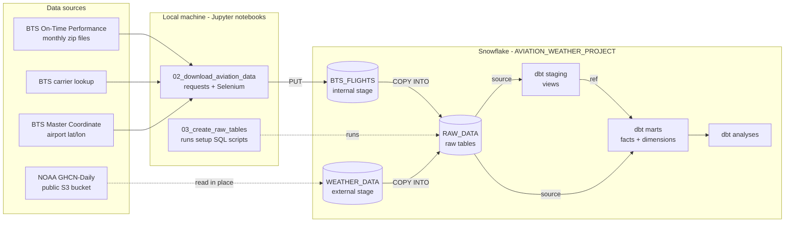
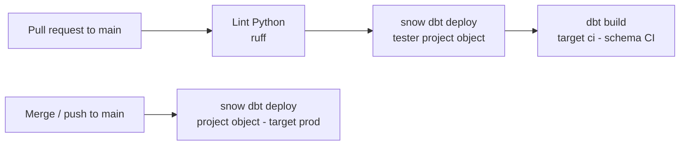

# Aviation Weather Investigation


[](LICENSE)

**How much does weather really delay U.S. flights?**
> An end-to-end analytics engineering project that combines U.S. flight performance data (BTS) with daily weather observations (NOAA) to measure how rain, wind, thunderstorms, fog and freezing conditions affect delays and cancellations at U.S. airports.

Built with **dbt** running natively on **Snowflake** (dbt Projects on Snowflake), with Python ingestion scripts and a tested, layered data model.

---

## 📌 Business Questions
 
1. Do days with heavy rain, strong wind or thunderstorms have higher delay and cancellation rates?
2. Which airports are most sensitive to bad weather, and which recover fastest?
3. How much of the weather impact is hidden in the **NAS delay** category instead of the official **Weather delay** category?
4. Which airlines handle bad-weather days best?

## 🏗️ Architecture
 
### Data flow
 

 
### CI/CD
 

**Key design decisions**
 
- **EL is separated from T.** Ingestion (downloads, stages, `COPY INTO`) lives in Python and SQL scripts outside dbt. dbt only transforms data that is already in Snowflake, declared as `sources`.
- **Airports are matched to weather stations by location, not by name.** Station and airport names never match reliably, so the project computes the distance between every airport and nearby NOAA stations with Snowflake's `HAVERSINE` function and keeps the closest station within 25 km.
- **dbt runs inside Snowflake.** The project is developed in a Git-connected Snowflake Workspace and executed with `EXECUTE DBT PROJECT`, with no external dbt server.


## 📊 Data Sources
 
| Source | Description | Grain | Access |
|---|---|---|---|
| [BTS On-Time Performance](https://www.transtats.bts.gov/Tables.asp?QO_VQ=EFD) | Every U.S. domestic flight with scheduled/actual times, delays and delay causes | One row per flight | Monthly zip files |
| [BTS Master Coordinate](https://www.transtats.bts.gov/DL_SelectFields.aspx?gnoyr_VQ=FLL&QO_fu146_anzr=N8vn6v10%20f722146%20gnoyr5) | Airport IDs, codes, latitude, longitude and UTC offset | One row per airport version | Web form (automated with Selenium) |
| [NOAA GHCN-Daily](https://registry.opendata.aws/noaa-ghcn/) | Daily weather observations: precipitation, temperature, wind and weather-type flags | One row per station, day and element | Public AWS S3 bucket |
 
**Period covered:** January 2025 – July 2026 <!-- TODO: update if you load more months -->
 
---

### CI/CD (`.github/workflows/`)

- **`incoming_pr.yml`** — Runs dbt checks against a dev environment when a PR is opened.
- **`pr_merged.yml`** — Deploys the dbt project to production when a PR is merged.

### Scheduling (`schedules.sql`)

Task definitions for running the dbt project on a schedule using Snowflake Tasks.

## 🚀 How to Run
 
### Prerequisites
 
- A Snowflake account (a 30-day trial works) with access to the `ACCOUNTADMIN` role
- Python 3.12 and Git
- Google Chrome (used by Selenium for the airport coordinates download)
- [Snowflake CLI](https://docs.snowflake.com/en/developer-guide/snowflake-cli/index), only to run the dbt project inside Snowflake from your machine
### 1. Clone the repo and install dependencies
 
```bash
git clone https://github.com/victorlos/aviation-weather-investigation.git
cd aviation-weather-investigation
 
python -m venv .venv
source .venv/bin/activate
pip install -r requirements.txt jupyter
```
 
### 2. Configure your credentials
 
```bash
cp .env.example .env
```
 
Fill in `.env` with your Snowflake account, user and password. Use `SNOWFLAKE_ROLE=ACCOUNTADMIN` for the setup steps, and set `GITHUB_PAT` to a GitHub token with read access to this repo (used to connect Snowflake to the repository). The `.env` file is ignored by Git and must never be committed.
 
### 3. Create the Snowflake infrastructure
 
Run **`notebooks/01_infrastructure_creation_snowflake.ipynb`**. It executes `notebooks/00_infrastructure_commands.sql`, which creates:
 
- the `AVIATION_WEATHER_WAREHOUSE` warehouse (X-Small, auto-suspend after 60 seconds);
- the `AVIATION_WEATHER_PROJECT` database and the `RAW_DATA` schema;
- the stages `BTS_FLIGHTS` (internal, for BTS files) and `WEATHER_DATA` (external, pointing to NOAA's public S3 bucket);
- the Git integration, and the service user and role used by GitHub Actions.
> Run the notebooks from inside the `notebooks/` folder, since they use relative paths.
 
### 4. Download the data and upload it to Snowflake
 
```bash
mkdir -p data/bts/_downloads
```
 
Then run **`notebooks/02_download_aviation_data.ipynb`**. It downloads the BTS monthly files (January 2025 – July 2026), the carrier lookup and the airport coordinates (with Selenium), and uploads them to the `BTS_FLIGHTS` stage with `PUT`. NOAA data doesn't need downloading, since Snowflake reads it directly from S3.
 
### 5. Create and load the raw tables
 
Run **`notebooks/03_create_raw_tables.ipynb`**. It executes every script in `dbt-aviation-weather/setup/`, which creates the five raw tables in `RAW_DATA` and loads them with `COPY INTO`. The first run takes a few minutes, mostly to load two years of global weather data.
 
### 6. Build the dbt models
 
**Option A: locally with dbt Core** (builds into the `DEV` schema)
 
```bash
cd dbt-aviation-weather
set -a; source ../.env; set +a     # dbt reads credentials from environment variables
dbt debug                          # checks the connection
dbt build                          # builds every model and runs all tests
```
 
**Option B: inside Snowflake with the Snowflake CLI**
 
```bash
set -a; source .env; set +a
export SNOWFLAKE_CLI_FEATURES_ENABLE_DBT=true
 
snow dbt deploy aviation_weather --source ./dbt-aviation-weather -x \
  --database AVIATION_WEATHER_PROJECT --schema CICD
snow dbt execute aviation_weather build -x \
  --database AVIATION_WEATHER_PROJECT --schema CICD
```
 
### 7. Run the analyses
 
dbt compiles analyses into plain SQL without executing them:
 
```bash
cd dbt-aviation-weather
dbt compile --select airport_most_delays
```
 
Then run the SQL from `target/compiled/aviation_weather/analysis/airport_most_delays.sql` in a Snowflake worksheet.
 
### 8. (Optional) Set up CI/CD in your own fork
 
1. **Create a programmatic access token (PAT)** for the CI user in Snowsight: *Governance & security → Users & roles → `GITHUB_ACTIONS_SERVICE_USER` → Programmatic access tokens*. Set the role restriction to `GITHUB_ACTIONS_ROLE` and choose an expiry date. Snowflake may require a network policy before it lets a service user create or use a PAT.
2. **Add GitHub secrets** (*Settings → Secrets and variables → Actions*): `SNOWFLAKE_ACCOUNT`, `SNOWFLAKE_USER` (`GITHUB_ACTIONS_SERVICE_USER`) and `SNOWFLAKE_PAT`.
3. **Add GitHub variables:** `SNOWFLAKE_DATABASE` = `AVIATION_WEATHER_PROJECT` and `SNOWFLAKE_SCHEMA` = `CICD`.
From then on:
 
- **`incoming_pr.yml`** runs on every pull request to `main`: it lints the Python code with ruff, deploys a tester dbt project object and runs `dbt build` against the `ci` target (schema `CI`).
- **`dbt_run_on_merge.yml`** runs on every push to `main`: it deploys the project object `aviation_weather_dbt_object_gh_action` with the `prod` target. To build production, execute it:
```sql
EXECUTE DBT PROJECT AVIATION_WEATHER_PROJECT.CICD.AVIATION_WEATHER_DBT_OBJECT_GH_ACTION
  ARGS = 'build';
```
 
---
 
## 🗂️ Repository Structure
 
```
├── .github/workflows/
│   ├── incoming_pr.yml          CI: lint + dbt build on pull requests
│   └── dbt_run_on_merge.yml     CD: deploy the dbt project on merge to main
├── notebooks/
│   ├── 00_infrastructure_commands.sql
│   ├── 01_infrastructure_creation_snowflake.ipynb
│   ├── 02_download_aviation_data.ipynb
│   └── 03_create_raw_tables.ipynb
├── dbt-aviation-weather/
│   ├── setup/                   SQL that creates and loads the raw tables
│   ├── models/
│   │   ├── staging/
│   │   ├── marts/
│   │   ├── sources.yml
│   │   └── test.yml
│   ├── analysis/
│   ├── tests/
│   ├── dbt_project.yml
│   └── profiles.yml             targets dev, ci and prod (no secrets)
├── .env.example
└── requirements.txt
```
