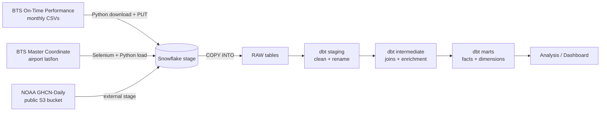

# Aviation Weather Investigation

**How much does weather really delay U.S. flights?**
> An end-to-end analytics engineering project that combines U.S. flight performance data (BTS) with daily weather observations (NOAA) to measure how rain, wind, thunderstorms, fog and freezing conditions affect delays and cancellations at U.S. airports.

Built with **dbt** running natively on **Snowflake** (dbt Projects on Snowflake), with Python ingestion scripts and a tested, layered data model.

---

## 📌 Business Questions
 
1. Do days with heavy rain, strong wind or thunderstorms have higher delay and cancellation rates?
2. Which airports are most sensitive to bad weather, and which recover fastest?
3. How much of the weather impact is hidden in the **NAS delay** category instead of the official **Weather delay** category?
4. Which airlines handle bad-weather days best?

## 🏗️ Architecture
 

**Key design decisions**
 
- **EL is separated from T.** Ingestion (downloads, stages, `COPY INTO`) lives in Python and SQL scripts outside dbt. dbt only transforms data that is already in Snowflake, declared as `sources`.
- **Airports are matched to weather stations by location, not by name.** Station and airport names never match reliably, so the project computes the distance between every airport and nearby NOAA stations with Snowflake's `HAVERSINE` function and keeps the closest station within 25 km.
- **dbt runs inside Snowflake.** The project is developed in a Git-connected Snowflake Workspace and executed with `EXECUTE DBT PROJECT`, with no external dbt server.

## 📊 Data Sources
 
| Source | Description | Grain | Access |
|---|---|---|---|
| [BTS On-Time Performance](https://www.transtats.bts.gov/Tables.asp?QO_VQ=EFD) | Every U.S. domestic flight with scheduled/actual times, delays and delay causes | One row per flight | Monthly zip files |
| [BTS Master Coordinate](https://www.transtats.bts.gov/DL_SelectFields.aspx?gnoyr_VQ=FLL&QO_fu146_anzr=N8vn6v10%20f722146%20gnoyr5) | Airport IDs, codes, latitude, longitude and UTC offset | One row per airport version | Web form (automated with Selenium) |
| [NOAA GHCN-Daily](https://registry.opendata.aws/noaa-ghcn/) | Daily weather observations: precipitation, temperature, wind and weather-type flags | One row per station, day and element | Public AWS S3 bucket |
 
**Period covered:** January 2025 – July 2026 <!-- TODO: update if you load more months -->
 
---

### CI/CD (`.github/workflows/`)

- **`incoming_pr.yml`** — Runs dbt checks against a dev environment when a PR is opened.
- **`pr_merged.yml`** — Deploys the dbt project to production when a PR is merged.

### Scheduling (`schedules.sql`)

Task definitions for running the dbt project on a schedule using Snowflake Tasks.

## How to Run 

